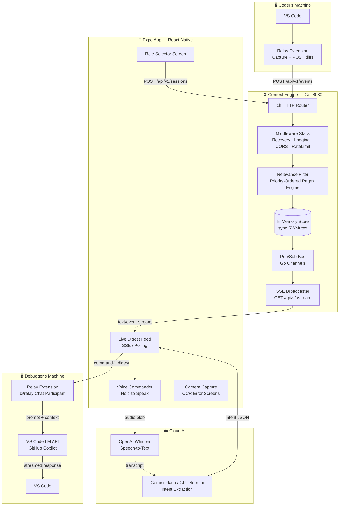
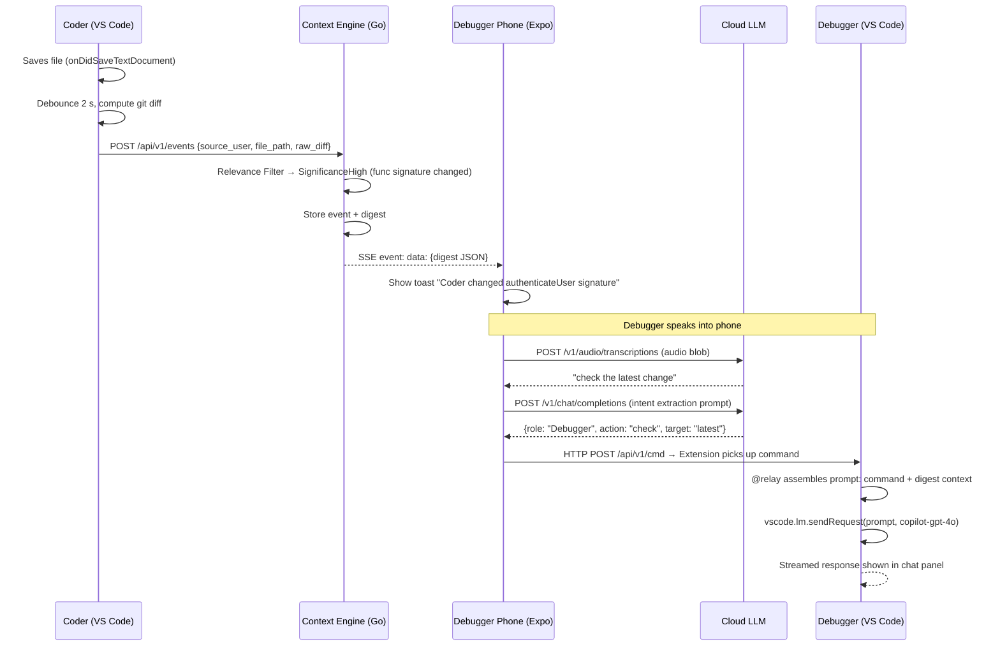
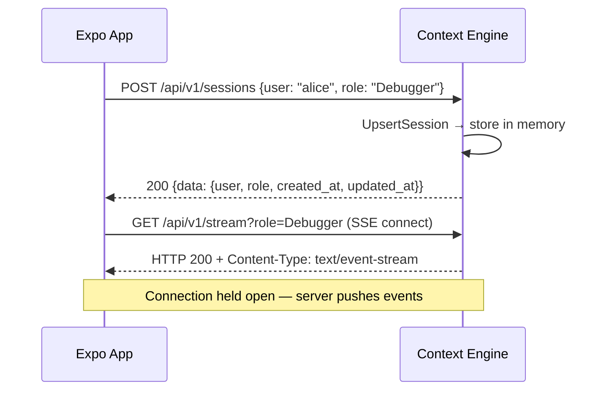
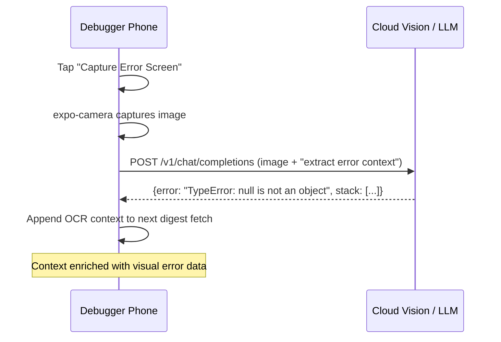
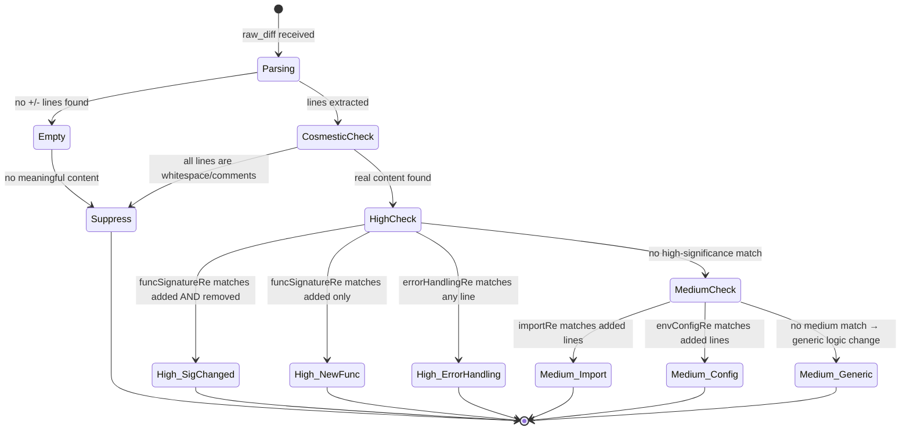

# Relay — Complete System Design

> **Version:** 2.0 | **Hackathon:** iQOO 2026, Hyderabad City Battle

## Overview

Relay is a **role-aware context layer** that silently synchronises AI assistant context between teammates in real time. It intercepts save events from the IDE, filters them for significance, and pushes a structured digest to the relevant team member's phone — which then injects that context into their AI assistant via voice or direct prompt injection.

---

## 1. Full Architecture



---

## 2. Component Responsibilities

| Component | Language | Responsibility |
|---|---|---|
| **Context Engine** | Go 1.22 | Event ingestion, relevance filtering, SSE broadcast |
| **VS Code Extension** | TypeScript | Diff capture, `@relay` chat participant, status bar |
| **Expo App** | React Native / TypeScript | Role UX, SSE client, voice STT, intent routing |
| **Cloud LLM** | OpenAI / Gemini | Speech transcription + intent JSON extraction |
| **VS Code LM API** | VS Code built-in | Generate response inside the IDE chat panel |

---

## 3. Sequence Diagrams

### 3.1 Main Flow: Code Save → AI Context Injection



### 3.2 Session Registration Flow



### 3.3 Camera OCR Flow



---

## 4. API Contract (Complete)

### Backend: Context Engine

#### `POST /api/v1/events`
Push a diff event from the IDE extension.

**Request:**
```json
{
  "source_user": "bob",
  "file_path": "src/auth/login.ts",
  "raw_diff": "-function auth(u) {\n+function authenticateUser(token: string) {",
  "timestamp": "2026-09-06T12:00:00Z"
}
```

**Response `201`:**
```json
{
  "data": {
    "event_id": "evt-uuid",
    "summary": "Function/type signature changed in auth/login.ts",
    "significance": "High",
    "target_roles": ["Debugger", "Deployer"],
    "diff_snippet": "function authenticateUser(token: string) {",
    "file_path": "src/auth/login.ts",
    "source_user": "bob",
    "created_at": "2026-09-06T12:00:01Z"
  }
}
```

#### `GET /api/v1/digest?role=Debugger`
Pull the latest relevant digest for a role. Used for initial load.

**Response `200`:** Same shape as above `data` object.
**Response `404`:** `{"code": "NOT_FOUND", "message": "no digest available for role: Debugger"}`

#### `GET /api/v1/stream?role=Debugger`
**SSE connection.** Server holds this open and pushes events as they arrive.

```
Content-Type: text/event-stream
Cache-Control: no-cache

data: {"event_id":"evt-001","summary":"...","significance":"High",...}

data: {"event_id":"evt-002","summary":"...","significance":"Medium",...}
```

#### `POST /api/v1/sessions`
Register or update a team member's role.

**Request:** `{"user": "alice", "role": "Debugger"}`
**Response `200`:** `{"data": {"user": "alice", "role": "Debugger", "created_at": "...", "updated_at": "..."}}`

#### `POST /api/v1/cmd`
Receive a command from the phone and route it to the correct IDE extension. Used by the Expo app to send voice commands.

**Request:**
```json
{
  "target_user": "alice",
  "command": "check the latest change",
  "intent": {"role": "Debugger", "action": "check", "target": "latest"},
  "digest_event_id": "evt-001"
}
```

#### `GET /health`
```json
{"status": "ok", "stats": {"events": 12, "digests": 12, "sessions": 2}}
```

---

## 5. Relevance Filter State Machine



---

## 6. Real-Time Messaging Design (SSE)

**Why SSE over WebSocket?**
- SSE is **one-directional** (server → client), which is exactly what we need for digest push.
- SSE reconnects **automatically** on disconnect (built into the browser/native EventSource).
- SSE is **simpler** to implement in Go: just a long-lived HTTP handler writing to `http.ResponseWriter`.

**SSE event format:**
```
data: <json>\n\n
```

**Store pub/sub design:**
- Each SSE connection calls `store.Subscribe(role)` which returns a `*Subscriber` with a buffered channel (`cap=8`).
- When `SaveDigest` completes, it calls `notifySubscribers(digest)` which sends to matching subscriber channels with a **non-blocking select** (drops if buffer full — tolerable for prototype).
- When the client disconnects (`r.Context().Done()`), the SSE handler calls `store.Unsubscribe(sub)`.

---

## 7. VS Code Extension Design

### Architecture
```
extension.ts       → Lifecycle (activate/deactivate), register all disposables
config.ts          → Read vscode.workspace.getConfiguration('relay')
capture.ts         → onDidSaveTextDocument → debounce → git diff → POST /events
relayClient.ts     → Typed fetch client for the Go backend
chatParticipant.ts → Register @relay chat participant, fetch digest, call vscode.lm
statusBar.ts       → Status bar item: role + last sync time
```

### Chat Participant Flow
1. User types `@relay check what changed`
2. Extension fetches `GET /api/v1/digest?role=<user_role>`
3. Builds system prompt: `"You are Relay, a context bridge. Context: [digest]. Answer the user's question."`
4. Sends to `vscode.lm.selectChatModels({ vendor: 'copilot', family: 'gpt-4o' })`
5. Streams response back to VS Code chat panel

---

## 8. Expo App Design

### Screen Architecture
```
app/
├── index.tsx       → Role Selector (animated glassmorphism cards)
├── dashboard.tsx   → Live Digest Feed + Voice button
└── camera.tsx      → Camera Capture + OCR submission
```

### State Architecture
- `useSession()` hook: persists `{user, role}` in `AsyncStorage`, registers with backend
- `useDigest(role)` hook: SSE listener + polling fallback, returns `RelevanceDigest | null`
- `VoiceService`: audio recording → Whisper API → LLM intent extraction → POST /cmd

### Design System
| Token | Value | Use |
|---|---|---|
| `bg.base` | `#080B14` | Screen background |
| `bg.surface` | `#0F1724` | Card / panel background |
| `glass` | `rgba(255,255,255,0.05)` | Glassmorphism card fill |
| `accent.primary` | `#6C63FF` | Coder role, primary actions |
| `accent.secondary` | `#00D4FF` | Debugger role, SSE indicator |
| `accent.deployer` | `#FFB800` | Deployer role |
| `sig.high` | `#FF4757` | High significance indicator |
| `sig.medium` | `#FFA502` | Medium significance indicator |
| `sig.suppress` | `#57606A` | Suppressed (never shown) |

---

## 9. Error Handling Strategy

| Layer | Error | Strategy |
|---|---|---|
| **VS Code Extension** | Backend unreachable | Show status bar error icon; retry with exponential backoff (1s, 2s, 4s, max 30s) |
| **VS Code Extension** | No Copilot model | Show `stream.markdown('⚠️ GitHub Copilot not installed')` in chat |
| **VS Code Extension** | Git not available | Skip diff capture; log warning |
| **Go Backend** | Store race | `sync.RWMutex` prevents races; all writes serialised |
| **Go Backend** | Handler panic | `recoveryMiddleware` catches, logs stack, returns 500 |
| **Go Backend** | SSE client disconnect | `r.Context().Done()` detected in SSE loop; subscriber cleaned up |
| **Expo App** | SSE disconnect | Automatic reconnect with 3s delay |
| **Expo App** | Whisper API fail | Show "STT unavailable, type your query" fallback |
| **Expo App** | LLM intent fail | Send raw transcript as command (best-effort) |

---

## 10. Security (Prototype Scope)

| Concern | Approach |
|---|---|
| Auth | **None** for prototype (LAN only). Production: API key via `Authorization: Bearer <key>` header. |
| Input size | `MaxBodyBytes: 512KB` on all requests via `bodySizeMiddleware` |
| CORS | `*` origin for prototype. Enumerate allowed origins in production. |
| Injection | All diff content stored as raw strings; only ever included in LLM prompts (not executed). |
| SSE flood | Subscriber channel is buffered (cap=8); excess events dropped non-blocking. |
